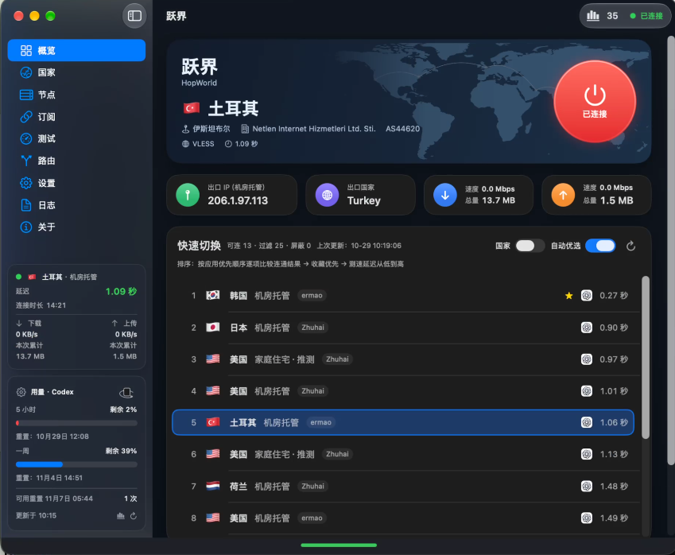
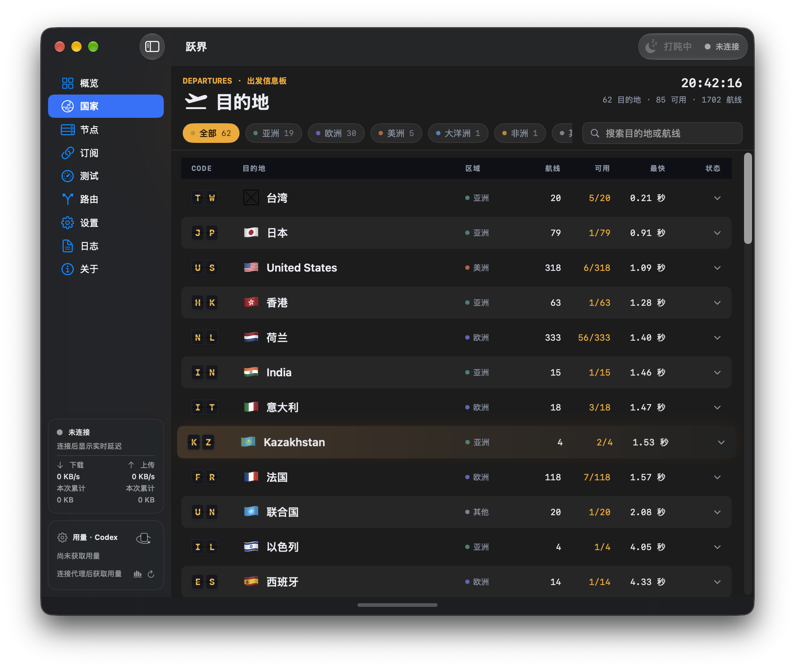
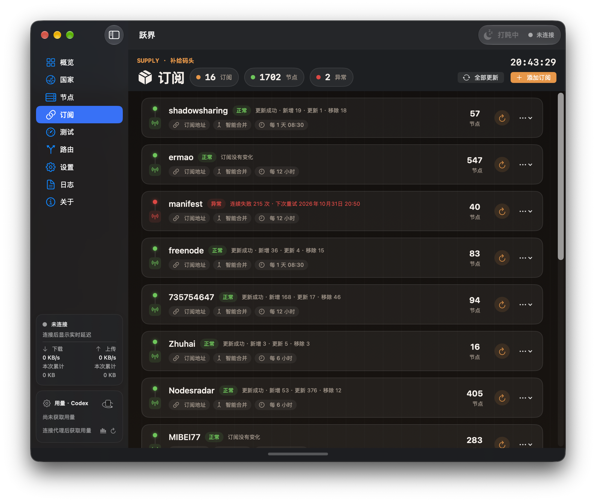
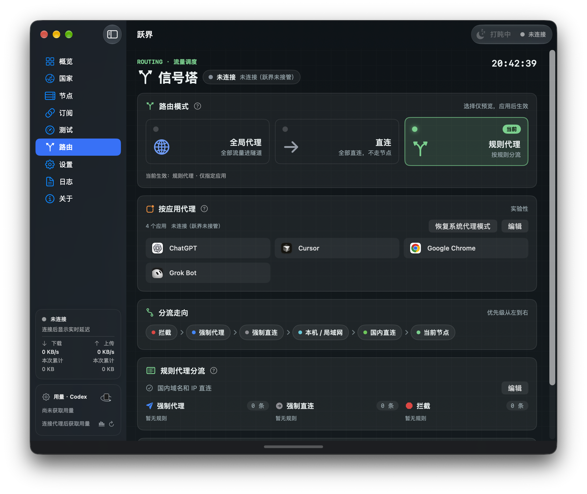

# 跃界 / HopWorld

macOS 原生可视化 Xray/V2Ray 代理客户端（SwiftUI）。

协议、传输、REALITY 与导入格式的支持范围见 [支持列表](docs/支持列表.md)。内核分工、维护入口和扩展流程见 [已支持协议与维护指南](docs/已支持协议与维护指南.md)。

HopWorld 自有源码采用 [MIT License](LICENSE)。外部代理内核及规则数据遵循各自上游许可证，MIT 授权不覆盖这些组件。分发包含第三方组件的安装包时，应保留对应版本的许可证、版权声明并满足其源码提供等要求。

左下角用量卡片可显示本机 **Codex** / **Cursor** / **Claude** 用量（Claude 读取本机 Claude Code 登录，首次手动刷新时需允许访问「Claude Code-credentials」钥匙串）；其中 **[Codex 重置提醒](#codex-重置提醒imessage)** 可通过 iMessage 在额度重置时通知你（默认关闭，见专节）。Cursor 用量通过只读打开本机 Cursor 登录数据库取得访问令牌；加密凭据需在启动后手动刷新一次并授权「Cursor Safe Storage」。发布问题或日志时，请勿附带登录数据库、令牌、订阅地址或节点凭证。

根据 `macOS_Xray_可视化代理客户端_开发文档_V1.0.md` 实现首版核心能力：订阅导入、日期型 URL、节点分类、测速、按国家一键连接、系统代理模式。

**2.0** 增加 [软路由](#软路由)：另开一份核心，给同一局域网的手机和平板用。其它设备不必再装自己的代理 App，本机正在用的连接也不会被换掉。安装包：[Apple Silicon](https://github.com/ZaoHub/HopWorld/releases/download/v2.0.0/HopWorld-2026-11-12-arm64.dmg)、[Intel](https://github.com/ZaoHub/HopWorld/releases/download/v2.0.0/HopWorld-2026-11-12-x86_64.dmg)，说明见 [v2.0.0](https://github.com/ZaoHub/HopWorld/releases/tag/v2.0.0)。

## 产品主页

落地页（启用 GitHub Pages 后）：[https://zaohub.github.io/HopWorld/](https://zaohub.github.io/HopWorld/)

仓库 Settings → Pages → Source 选 `main` / `/docs` 即可发布。About 的 Website 可填同一地址。

## 界面预览

<p align="center">
  
</p>

| 首页 | 国家页 |
| :---: | :---: |
|  |  |

| 订阅页 | 路由页 |
| :---: | :---: |
|  |  |

<p align="center">
  
</p>

## 环境

- macOS 13.0+
- Xcode 15+
- [XcodeGen](https://github.com/yonaskolb/XcodeGen)

> **系统 VPN**（Network Extension）仅在自行签名的构建中可用，需付费 Apple Developer 账号，见下文「启用系统 VPN」。公开发布的安装包不显示该选项。

## 从源码构建

在仓库根目录执行：

```bash
xcodegen generate
open HopWorld.xcodeproj
```

在 Xcode 中常规本地运行即可使用**系统代理**。源码仓库不包含代理内核与规则数据；首次连接、测速或打开「关于 → 管理更新」时，应用会在线下载并安装到本机（见下文）。若希望把内核打进工程资源（例如离线构建），可先运行 `bash Scripts/fetch_xray.sh`（工程可引用 `geoip.dat` / `geosite.dat`）。

命令行本地构建：

```bash
xcodebuild -project HopWorld.xcodeproj -scheme HopWorld -configuration Debug -derivedDataPath build build
```

分发安装包时须另外核对所含内核架构、第三方许可证、应用签名和公证状态。

### 启用系统 VPN（本机测试）

默认构建为 ad-hoc 签名，不含 Network Extension 权限，系统 VPN 不可用。本机测试系统 VPN 需要**付费** Apple Developer Program 账号（免费 Apple ID 不支持 Network Extension）：

```bash
cp Configs/Signing.local.xcconfig.example Configs/Signing.local.xcconfig
# 编辑：填写 HOPWORLD_DEVELOPMENT_TEAM，并把 HOPWORLD_BUNDLE_PREFIX 换成你自己的反向域名
xcodegen generate
```

`Signing.local.xcconfig` 已被 git 忽略。Bundle ID 与 App Group（`group.<前缀>.app`）在 Apple 后台全局唯一，fork 时必须使用自己的前缀。在 Xcode 登录该账号后构建一次，自动签名会注册 App ID、App Group 与本机。

构建后建议把 App 放到 `/Applications` 再运行。在 **路由** 选择「规则代理」，会出现「接管方式」卡片，切换为「系统 VPN」后连接节点；首次连接时 macOS 会请求添加 VPN 配置。系统 VPN 不依赖应用是否遵循系统代理，并显示在「系统设置 → 网络」的 VPN 列表中。

这种 Development 签名的包只能在已登记的 Mac 上运行，因此公开发布的安装包仅支持系统代理等其他模式；需要系统 VPN 的用户请按上述步骤自行构建。

## 安装 Xray / 组件更新

日常使用**不必**手动跑脚本或 Homebrew。打开应用后：

1. 进入 **关于 → 组件更新 → 管理更新**
2. 在 Xray 卡片中检查并安装（可选手动选版本；稳定版可走自动更新）
3. 下载失败时，在同一弹窗切换**下载线路**（GitHub 直连或镜像）后重试

首次**连接节点**或**测速**时，若本机尚无可用核心，也会自动下载默认稳定版并安装到 `~/Library/Application Support/HopWorld/`（优先 `current/xray` 托管路径）。安装后下次连接或测试生效；已在跑的连接不受影响。

同一弹窗还可管理 **sing-box** 与 **GeoFiles**：

- sing-box 保留 `1.14.2` 基线，可更新至已适配的 `1.14.4`。两个版本均按架构固定官方 SHA-256；安装候选版本前检查全量/分应用 TUN 及 VLESS、TUIC、AnyTLS、Hysteria2、旧 Shadowsocks 桥接配置。更新版通过后才切换，后续未适配的上游版本只提示。
- GeoFiles 独立取自 [Loyalsoldier/v2ray-rules-dat](https://github.com/Loyalsoldier/v2ray-rules-dat)，从同一发布下载 `geoip.dat` / `geosite.dat` 并校验各自官方摘要，用本地 Xray 检查规则后成套切换。独立规则优先于 Xray 随附规则，后续更新 Xray 不覆盖独立规则。
- 启动时会触发自动检查。Xray：同一自然日若已检查过，自动流程会跳过联网刷新，但在开启自动更新时仍可安装已缓存的官方稳定版。sing-box / GeoFiles：关闭自动更新时同日跳过联网检查；开启自动更新时每次启动都会刷新。自动更新默认开启；Xray 仅自动安装官方稳定版，预发布版需手动选择。所有组件共用下载线路设置；候选校验失败时保留原版本。

### 可选：命令行预置（开发 / 离线）

仅在需要预先放入工程资源或本机路径时使用：

```bash
chmod +x Scripts/fetch_xray.sh
./Scripts/fetch_xray.sh
```

脚本按当前 Mac 架构拉取官方 release，写入 `HopWorld/Resources/xray` 与 `~/Library/Application Support/HopWorld/xray`（与「管理更新」的 `current/xray` 布局不同）。也可安装 Homebrew 的 `xray`：存在托管版时优先托管；否则在本机可执行候选中选择版本较新者。

## 使用流程

1. 打开 App → **订阅** → 添加订阅地址或导入分享链接
2. 若识别为日期型 URL，确认使用自动日期模板
3. 进入 **测试** 或等待更新后自动测速；需要时可在 [应用连通](#应用连通) 检查 ChatGPT、Claude 等能否打开
4. 在 **路由** 选择接管方式：规则代理下的系统代理（默认）、全局 TUN，或规则代理下的「仅指定应用」TUN（自行签名构建还可选系统 VPN）；再在 **概览 / 国家 / 菜单栏** 连接节点
5. （可选）在测试设置中开启节点元数据中文城市显示；首次会从 GeoNames 生成离线库到本机 Application Support，之后优先离线匹配

默认本地端口（系统代理入口，可在设置中修改）：

- SOCKS：`127.0.0.1:10808`
- HTTP：`127.0.0.1:10809`

## 软路由

路由页的软路由再开一份 Xray，只给同一局域网的其它设备用。它不替换本机主连接，也不改系统代理、TUN 和当前节点。

- 局域网地址固定为 HTTP `17890`、SOCKS5 `17891`。这和上面的本机系统代理端口不是同一对。
- 手机和平板不必再装自己的代理 App。把系统代理指到这台 Mac 的局域网地址即可，不需要密码，也不需要 Shadowrocket 一类客户端。
- 可以只测勾选的订阅组；禁用的组也能用于软路由。测出时延后可以自动优选。
- 转发过程中可以按实测延时换线：超过设定秒数就按排名切到下一个；前若干个仍不达标时，会更新勾选的订阅并重新测试。也可以定时测试、定时更新订阅。这些定时不改主应用自己的定时。
- 指定国家和排除国家按已测到的出口，不看节点名称。
- 目前只使用 IPv4 局域网地址。首次开启时，系统可能会询问是否允许入站连接。用完请断开。

### 使用教程

Mac 和手机、平板要在同一个局域网，通常是同一个 Wi-Fi。

1. 打开 **路由**，点时间下方的 **软路由**。
2. 展开 **策略与订阅**，点 **编辑**。勾选要测的连通目标，再勾选订阅组。已经禁用的组也能勾选，只给软路由用。
3. 想测完自动连上排第一的节点，勾上 **自动优选**。转发中要按延时换线，打开 **延时换线**，再设超过多少秒、在前几个节点里切换。定时测试按分钟，定时更新订阅按小时。点 **完成**。这些定时不改主应用自己的定时。
4. 点 **测试**。只有测出时延的节点会出现在列表里。选一个，点 **连接此节点**。开了自动优选时，测试结束后会自己连上排第一的节点。
5. 状态变成「正在转发」后，展开 **局域网代理地址**。有多条地址时，选和手机同一网段的那条。HTTP 端口是 `17890`，SOCKS5 是 `17891`。可以点 **复制**。
6. 在其它设备上把系统代理设为手动：服务器填这台 Mac 的局域网 IP，端口填 `17890`，认证关掉。不需要用户名和密码，也不需要再装代理 App。
   - iPhone：设置 → 无线局域网 → 当前网络右侧 ⓘ → 配置代理 → 手动
   - Android：长按当前 Wi-Fi → 修改网络 → 高级 → 代理选手动
7. 系统代理用 HTTP。SOCKS5 `17891` 只给能单独设置 SOCKS 的应用。
8. 用完后，把手机代理改回关闭，回到软路由面板点 **断开**。

首次开启时，系统可能会询问是否允许入站连接。目前只使用 IPv4。`17890` 被占用时会直接失败，不会改到别的端口。本机主连接、系统代理、TUN 和当前节点都不会改。

## Codex 重置提醒（iMessage）

跃界可在 **Codex 周额度重置**、**可用重置次数增加**，或 **最近一笔可用重置即将到期** 时，通过本机「信息」发送 iMessage。功能默认关闭；不经过任何远程服务器，收件人与监测基线只保存在本机。

### 如何开启

1. 左下角 **Codex 用量卡片** → 齿轮 → **通知**
2. 打开「启用 iMessage 通知」
3. 添加收件人（iMessage 手机号建议带国家/地区码如 `+86`，或 Apple 账号邮箱），勾选要接收的人
4. 点击 **应用设置** 保存（筛选只缩小列表，不改变勾选；编辑/删除也在应用后生效）

请先在本机「信息」登录 iMessage。首次发送时 macOS 会请求自动化权限；若拒绝，可到「系统设置 → 隐私与安全性 → 自动化」允许跃界控制「信息」。

### 何时会提醒

| 情况 | 行为 |
| --- | --- |
| 首次开启 | 只建立基线，**不发送**；等待之后的变化 |
| 周余量恢复到精确 **100%** | 提醒（视为官方周重置一类信号） |
| 周余量保持 100%，且周重置时间移动超过 1 小时 | 提醒。不足 1 小时的时间跳动视为同一窗口，不重复发送 |
| 可用重置次数 **增加** | 提醒；若与周额度提醒同时发生，**合并为一条** |
| 可用重置次数 **减少** | 视为手动重置，**抑制**当次周额度提醒 |
| 最近一笔可用重置到期 | 到期前 **1 天、5 小时、3 小时、30 分钟、5 分钟** 各提醒一次。第一次读到时若已进入某个时段，只发当前这一次，更早的不补发 |
| 购买额度 / 读数失败 | **不参与**判断、不触发 |

不要求等到原定周到期时间；按相邻成功读数推断。基线按 Codex 登录账号隔离并持久化；账号切换会取消尚未提交的发送。

### 监测与发送条件

- 随 Codex 用量约每 **5 分钟**检查一次。到期提醒在跃界保持运行时还会按上述时间点直接触发
- 通知已开启但读不到实时用量时，右下角记一条，提醒保持代理连接。打开消息后未读数量清零；重新读到用量之前不重复记
- 需要 **跃界正在运行** 且 **代理已连接**；关闭主窗口后仍继续监测
- **退出应用**或**系统睡眠**期间不发送
- 仅向当前勾选收件人分别发送；同一账号重复勾选只发一次
- 设置页显示提交结果：**提交成功 ≠ 对方已读**；失败或中断**不自动重试**（避免重复轰炸）

### 测试发送

通知页的「测试发送」会向**当前勾选**收件人实际发出一条测试 iMessage：

- 不必先开启自动通知，也不必先点「应用设置」
- **不改变**监测基线与自动开关
- 发送进行中不可重复点；提醒规则、收件人、权限说明可点对应 ⓘ 查看

## Codex 用量与 Token 统计

用量卡片底部的统计按钮可查看 5 小时（每 30 分钟）和一周（从周重置起每 5 小时）的输入、输出及缓存输入 Token，并回看实际记录的前后额度周期。数据来自本机 `CODEX_HOME`（默认 `~/.codex`）会话与归档；能识别额度账号时仅统计该账号。缓存输入已计入输入；**本机 Token 记录不等同于订阅额度或账单**。

周期由历史额度重置记录重建，不按最新时间固定回推。新 5 小时窗口以其重置时间减去 5 小时为起点；前后周期半开区间，重置时刻 Token 计入新一期。缺少历史时标注「起点推算」「下次重置未获取」。可按模型及推理档位筛选；「额度下降」页签显示观测区间净下降（异常回退以 * 标注）。图例旁可切换柱状图/折线图。

## 应用连通

测速只回答「节点延迟如何」；**应用连通**再经该节点的本地代理，探测常用网站/服务能否打开，便于判断 ChatGPT、Claude、GitHub 等是否真能用。只检查 HTTPS 可达性，**不会启动本机 App**，也**不会改变**「按应用代理」白名单。

入口：**测试中心 → 应用连通**（也可用「测试仪表」/左侧进度栏看进度）。设置里的「自动测试可用节点的应用连通」与卡片上的「测速后自动测试应用连通」是同一开关，**默认关闭**。

### 探测名单

| 来源 | 说明 |
| --- | --- |
| **默认应用** | 内置：Google、Cloudflare、ChatGPT、GitHub、YouTube、X/Twitter、Claude、TikTok |
| **按应用代理名单** | 跟随「路由 → 按应用代理」已保存列表；浏览器类默认测 Google；Codex/ChatGPT、Claude、Cursor 等按名称/Bundle 映射探测 URL；没有对应网址的应用需自行填写 |
| **自定义应用** | 自行挑选本机应用并配置探测 URL |

未配置「按应用代理」名单时默认用「默认应用」；名单非空时默认跟名单。可在卡片里切换来源、调整顺序、停用个别目标；改完需应用设置。默认探测超时 **5 秒**（可在应用连通或测试设置中改）。

### 怎么测

1. **单节点**：在应用连通卡片选节点（或测当前已连接节点），对名单中各目标逐个探测；节点行可显示哪些应用通过。
2. **批量可用节点**：在「应用连通 → 可用」选全部或指定节点组，点 **测试可用节点**，重测范围内所有启用、未待删除且测速判定可用的节点。
3. **测速后自动**：开启开关后，手动或后台测速结束会继续测本轮可用节点的应用连通；关闭时测速结束不再自动补测，仍可手动点「测试可用节点」。

批量应用连通**不切换当前代理**，可独立停止；与延迟测速并行时分别计数进度。探测未能启动或被取消时，**不会**把结果存成「全部不通」。订阅手动更新后的「手动测试」、定时更新后测新节点，是否继续应用连通同样遵循上述开关。

### 结果怎么用

- 节点列表可区分「延迟可用」与「应用连通通过」；关自动应用连通时概览侧重延迟可用，开启且探测结束后可按应用连通汇总。
- 开启自动应用连通后，**自动优选**会在测速结果之上，再按应用优先顺序比较连通，并结合收藏偏好与延迟排序；关闭时自动优选只按测速延迟。
- 网络健康中心里可映射到 Codex / Claude / Cursor 的诊断应用，来自当前启用的应用连通目标。

## 已实现（V1 核心）

### 规则代理

在「路由」选择「规则代理」，默认国内域名（`geosite:cn`）和 IP（`geoip:cn`）直连，其他流量走当前节点。可以关闭国内直连。

「强制代理」「强制直连」「拦截」各支持每行一条规则：

- `example.com` 或 `domain:example.com`：域名及其子域名。
- `full:example.com`：只匹配该域名。
- `1.2.3.4`、`10.0.0.0/8`、`2001:db8::/32`：IP 或网段。
- 空行和 `#` 开头的注释会忽略。国际化域名请使用 Punycode。

自定义规则按「拦截 → 代理 → 直连」优先匹配，随后匹配本机/局域网和国内直连，未匹配流量使用当前节点。使用 `IPOnDemand`，自定义 IP 规则也可覆盖内置国内域名规则；重叠规则不按网段长短排序。行为依据 [Xray 路由文档](https://xtls.github.io/config/routing.html)。

点击「保存并应用」保存配置；规则代理已连接时会重连当前节点。全局/直连模式忽略自定义规则。输入不合法时会提示且不保存；旧设置会自动补齐新增字段。

规则可随 Xray 安装附带，也可在「关于 → 管理更新」中独立更新 GeoFiles；运行时明确指定资源目录。系统代理只能接管遵循系统代理设置的应用。

`DefaultRouting.json` 是参考配置；实际连接配置由 `XrayConfigBuilder` 和 `RoutingRules` 生成。

### 全局代理（全量 TUN）

选择「全局代理」后连接节点并完成管理员授权，即启用全量 TUN。所有应用的公网 TCP/UDP 连接默认交给当前节点，包括无法识别所属进程的连接，不依赖系统代理或应用白名单。代理核心的外连直连以防回环；本机回环和系统更具体的本地路由仍由系统处理。SOCKS/Xray 链路不承载任意 IP 协议（例如 ICMP）。

全局 TUN 接管系统 DNS，通过节点访问远程 DNS；仅节点域名的引导解析走直连 DNS，避免递归依赖。断开时由核心释放 TUN 路由和接口 DNS。取消授权或启动失败不会退回系统代理。路由页面显示实际接管状态；旧版保存的全局配置在加载时也迁移到全量 TUN，下次连接生效。

### 仅指定应用代理（TUN，实验性）

先在「路由」选择「规则代理」，才会显示「按应用代理」；全局和直连模式不显示、也不启用应用白名单。全局模式自动启用全量 TUN，所有 App（包括 Cursor 和包外辅助进程）无需单独勾选，应用列表为空或路径失效也不影响连接；直连模式恢复系统代理接管。保留已保存的应用列表；从全局/直连返回规则模式且名单非空时，自动恢复「仅指定应用」接管，避免界面仍显示名单却实际走系统代理。规则模式下可随时点「恢复系统代理模式」改回全量系统代理。

在「按应用代理」添加 Codex 等 `.app`（也可搜索运行中的应用），点击「保存并选择应用代理模式」，再连接节点。未连接时只保存设置；已连接时按钮显示「保存并切换为应用代理」，先断开并重新连接。页面分开显示「已保存模式」与「实际接管状态」：只有连接成功才标记已生效，列表的未保存修改会另行提示。每次启动 TUN 使用 macOS 管理员授权，不要求 Apple Developer 会员，也不安装开机启动的 root 服务。

- 使用官方 **sing-box 1.14.2 / 已适配更新版 1.14.4** 的 TUN 和 `process_path_regex`，白名单公网连接经带随机密码的本地 SOCKS 入口交给现有 Xray 节点；其他连接默认 direct。Xray 的外连优先直连，防止回环。该模式不使用域名规则/国内分流开关。
- 同一 `.app/Contents/` 下的 Helper、后台可执行文件自动包含。包外启动的 `git`、`curl`、语言运行时等不自动继承；可单独添加可执行文件，但会匹配该路径下的所有实例，而非只匹配某个父应用启动的实例。移动应用后需重新添加。
- 局域网及无法识别所属进程的普通连接直连；分应用模式不接管系统 DNS，53 端口优先直连，避免节点异常影响未选中应用的本地解析。此功能是应用分流，不是防泄漏隔离/断网保护。应用原有长连接可能需重建或重启应用后才被捕获。
- 其他应用虽然不经过代理节点，公网流量仍可能经过本机 TUN 转发。因此不能承诺零性能开销或零丢包。其他 VPN/TUN 和系统 HTTP/SOCKS/PAC/WPAD 代理应先关闭；检测到冲突会拒绝启用，不擅自改写第三方配置。
- 首次下载核心需要访问 GitHub。固定发行版本及归档 SHA-256；校验失败不提权。管理员启动前将核心、配置与监护程序复制到 root 独占临时目录，再次核验摘要。应用无法向 root 进程发送任意命令；控制文件拒绝符号链接、硬链接及不安全权限。
- 断开会撤销心跳租约，监护程序终止自己启动的核心，等待 utun 释放后才确认停止。App 异常退出后，心跳租约默认约 10 秒失效，连同清理后界面通常提示约 13 秒内恢复本地网络（不含休眠时间）；机器休眠/系统失去调度时不能保证此墙钟时间。取消授权不会降级成系统全局代理。
- 点击「恢复系统代理模式」切回规则模式的系统代理。应用代理异常退出不自动恢复为全局代理。

实现依据：[sing-box TUN](https://sing-box.sagernet.org/configuration/inbound/tun/)、[进程路径规则](https://sing-box.sagernet.org/configuration/route/rule/)。核心由 [SagerNet/sing-box](https://github.com/SagerNet/sing-box) 提供，遵循其 GPL-3.0 许可证；下载归档包含 LICENSE，未修改核心。

管理员集成测试默认跳过。手动设置 `HOPWORLD_PRIVILEGED_TUN_TEST=1`、`HOPWORLD_TEST_SING_BOX`（官方核心绝对路径）、`HOPWORLD_TEST_TUN_SUPERVISOR`（构建产物绝对路径）后运行 `ApplicationProxyPrivilegedTests`，会请求系统授权，只临时接管文档保留地址 `203.0.113.7/32`，不改默认路由/DNS。测试比较白名单 curl 与另一可执行路径的 curl，并核对结束后的原路由。

### 网络健康中心

主窗口顶部连接状态前方的图表按钮直接显示当前已连接节点的实测评分数值；未连接时显示月亮图标与「打盹中」，采样不足时显示星光图标与「热身中」，悬停可查看覆盖率。点击数值入口打开完整的网络健康中心独立窗口，包含「节点」「应用」「记录」「评分」四项。首次默认显示「应用」，再次打开同一节点时保留正在查看的标签；⌘1～⌘4 可切换标签。节点详情保留基本信息、测速、连接参数和分享，原评分区已移至健康中心。

「应用」以「状态 N 未检测 / 检测中 / 正常 / 异常」展示四项：状态 1（经当前节点探测 `GET /referrals/invite/eligibility`；通过为正常，失败或 Codex 自身该请求失败为异常）、状态 2（无法加载工作空间设置）、状态 3（正在重新连接）、状态 4（等待网络）。页面文案统一用「状态 N」，不写「邀请资格」等内部说法。检查使用本机 Codex app-server 的登录状态，令牌仅存在于单次请求内存中；请求固定官方 HTTPS 地址并拒绝重定向。

状态 2 至 4 的判定（没有异常记录本身不算正常）：

| 状态 | 判定条件 |
| --- | --- |
| **异常** | 日志或界面里出现了对应提示（无法加载工作空间设置 / 正在重新连接 / 等待网络） |
| **正常** | 完整读取了 Codex 界面，确认提示没出现；状态 2 可依据本次连接中晚于故障的「收到回复」日志；状态 3、4 还可以依据本次连接里的「连接就绪」或「收到回复」日志，且之后没有故障 |
| **检测中** | 界面能读取，但这一轮没扫完，还确认不了 |
| **未检测** | 读不到界面（例如 Codex 窗口隐藏、最小化，或没给辅助功能权限），本次连接也没有能证明正常的日志 |

界面状态检测需要在 macOS「系统设置 → 隐私与安全性 → 辅助功能」中允许跃界读取 Codex 界面；健康中心提供设置入口，不会自动授予权限。检测只读取当前可见且能通过辅助功能访问的工作空间提示和网络状态。窗口隐藏或界面无法读取时，不当作故障或恢复。未授权时仍读取明确的重连日志，不以后台普通请求报错或对话空闲推断连接失败。界面检测的真实运行效果仍需在已授权的 Codex 窗口中验证。

「节点」明确显示“不能用”“能用但容易超时”“能用但很慢”“能用”四种状态，采样不足时显示“待检测”。有成功结果但夹杂多次超时的节点仍视为能用；成功请求通常较慢时单独提示速度问题。只有最近连续 3 次检测均失败，且每次均按至少 15 秒或用户配置的更长等待预算（最高 99 秒）完成确认，才确认“不能用”。偶发超时、速度慢和候选速度筛选不会单独断开仍能使用的当前节点；持续不可用后才按自动恢复设置处理。

节点页展示当前连接的出口 IP、属性、国家、城市、运营商与 ASN；未连接时回退到该节点最近保存的出口信息。另保留 HTTPS 成功率、P95、请求延迟抖动、出口变化及自动链路检查。连接代理后自动补足 10 次 HTTPS 样本，最多 3 个请求并发；短时检测失败后，后续确认会增加等待时间，避免把响应慢误判为不能用。可手动刷新基础评分或停止采样。WebSocket 快检观测约 10 秒，UDP 并行发送 30 个请求、间隔 50ms，已有测量先计分，不必等 6 分钟。6 分钟长时稳定性观察放在可展开的可选项中，运行时保留仍有效的已有结果。

HTTPS 与专项结果按测速有效期过滤，过期结果不参与参考分；后台自动补测到期的专项，未验证的 UDP 或未完成目标时长的 WebSocket 至少等待 60 秒再检查。手动停止专项会暂停本次连接的自动专项，点击「继续快检」或重新连接后恢复。自动测量只针对当前代理节点，不切换节点；出口变化标明为本次运行内累计。「应用」集中显示诊断汇总；实测得分与逐项贡献统一位于「评分」，不在节点页重复展示。

「记录」按节点仅保留最近 10 条 Codex 事件（包括主动状态 1 检查）；Claude / Cursor 检查按节点与应用各保留最近 10 条，内部切换历史保留最近 10 条。旧文件加载时按新上限裁剪并保存，超出记录不再保留。修改同一节点配置仍保留统一节点关联，旧配置证据不参与新配置评分。可筛选时间、事件类型和环境、复制摘要或导出保留的筛选结果；导出不含原始日志、节点地址、网络标识、请求标识或登录令牌。评分只使用保留样本，样本不足时显示不足，不补分。

自动切换配置统一位于「设置 → 连接」，修改后点击「应用设置」保存，对所有节点生效，无需逐个节点配置。连接超时可设为 1–99 秒，默认 15 秒，已有自定义值会保留。连接节点时不再做测试地址连通性验证，核心就绪并完成接管后即视为已连接；测速结果供选节点使用，不作为连接门槛。网络变化和唤醒后仍会复验当前连接：失败时当前节点最多再复验一次，两次验证共享固定总等待上限；默认首次等待 15 秒，总等待上限 30 秒，最高不超过 99 秒。直连模式不经节点，网络复验也跳过测试地址探测。已删除独立的“ChatGPT 连通性检测”开关和额外连接门槛；ChatGPT 测试地址仍可作为普通测试地址选择。

「应用健康智能切换」需与「自动故障切换」和概览中的「自动优选」同时开启，并由 TUN 接管 Codex、Claude 或 Cursor。Codex 主要依据状态 2「无法加载工作空间设置」、状态 3「正在重新连接」、状态 4「等待网络」的持续异常判断是否切换；Claude 与 Cursor 在无法加载 Claude 模型且持续未恢复时同样切换备用节点。状态 2 单独异常时至少观察 30 秒；状态 3、状态 4，或节点仍能用但容易超时或很慢时，至少观察 60 秒。连接超时配置更长时，以该值作为基础观察时间（配置最高 99 秒），持续未恢复才连接下一个备用节点。状态 1 异常是辅助信息，不会单独触发切换；普通后台请求错误也不会扩大为对话连接故障。故障期间首次取得新的状态 1 检查成功结果，仍提供一次额外观察阶段；同一故障反复检查成功不会不断延长截止时间，也不会缩短上述等待。后台每 2 秒检查并显示剩余时间。网络、连接、应用进程或接管条件变化会重置计时。认证、限流及服务端异常单独显示，健康中心不显示切换记录。

候选无需先取得真实会话历史评分。恢复前固定优选顺序，从当前节点之后依次直接连接；失败继续后一个节点，本轮已失败节点不会重新插入前方，也不回退原故障节点。没有隐式 3 个候选上限，有限候选模式仍遵循已保存的最大尝试数，未尝试的节点由后续批次继续。连接成功后立即结束本次切换任务，由原有后台监测在新节点上重新累计故障时间；没有额外的切换前预检或连接后验证等待。正常核心启动和连接校验仍按原有连接流程执行。成功后继续监测新故障，不再全局冷却 5 分钟；整轮候选耗尽才暂停 30 秒重新检查。连接进入异常时，自动故障切换会继续顺序恢复，队列全部失败后重新测速并再尝试一轮。接管授权取消、接管配置或清理错误则暂停本次自动恢复，等待手动处理。手动操作、网络、Codex 进程或设置变化会取消过期任务。

后台每 10 秒主动检查状态 1，当前结果过期后重新等待检查，不把历史成功当作本次连接正常。状态 1 只记录辅助状态，不计入对话完整请求成功率、真实会话评分或节点隔离，也不能代替状态 2 至 4 的恢复证据。没有对话、没有新回复或日志暂时没有更新均不会被推断为请求网络失败。

回复采集同时监听 Codex 应用日志与本机桌面主会话的回复元数据，只识别回复时间、角色与阶段，不解析或保存正文。忽略用户输入、工具输出、子代理及非桌面来源；启动时已有会话停在文件末尾，后续增量按预算轮询，旧内容不重放成新节点证据。会话元数据用于确认应用收到回复和结束故障计时，不能确认公网节点归属，不计入真实会话评分。


「评分」优先展示已取得的实测链路分与逐项贡献：HTTPS 延迟抖动 15、HTTPS 请求成功率 20、HTTPS P95 延迟 15、UDP 往返丢包 15。HTTPS 相关项至少需要 10 条有效样本；已验证的 WSS / UDP 可单独计分。10 秒 WebSocket 快检最多覆盖 10 分，自动快检合计最多覆盖 75 分；可选的 6 分钟 WebSocket 观测将该项覆盖提高到 35 分，完整参考链路最多覆盖 100 分。得分显示为“已测得分 / 100”并标明覆盖率，缺项不补分或归一化放大。这些公开端点测量不证明真实 Codex 会话持续可用。

完整应用请求评分保留在独立的可展开验证区，按节点与网络、接管、出口环境分别统计。请求结果只使用带去敏唯一请求标识的 `responseCompleted` / `requestFailure`；至少 5 个不同请求、跨度达到 20 秒，并有有效可用时段证据才计算总分，响应片段不增加请求成功率。稳定性为 `1 − min(1, 公网重连及连接失败事件数 / 可核实请求数)`，权重为可用占比 45、请求成功占比 30、稳定性 20。延迟未采集时最多覆盖 95%，未知项目不填零分或满分。

当前真实 Codex 会话评分的数据采集尚未完整接通：日志可能只提供本地桥接、路径未知事件和响应片段，缺少可核实的完整请求结果。健康中心会显示最近 15 分钟已识别的诊断和评分采样进度，并明确无法评分的原因；无法确认节点归属时不把连接故障显示为“0 次”或把隔离状态显示为“未隔离”。符合上述工作空间加载、重新连接或等待网络条件的事件通过独立恢复计时驱动上述延长观察策略，不会转换成业务成功率、节点隔离或真实节点评分。日志回放与本地测试不代表真实 Codex 会话及实际 TUN 切换验收。

历史参考评分及公开端点测试设计见 [Codex 连接稳定性与节点评分](docs/Codex连接稳定性与节点评分.md)、[Claude 连接稳定性与节点评分](docs/Claude连接稳定性与节点评分.md)、[WebSocket 与 UDP 专项实测](docs/WebSocket与UDP专项实测.md)，其中旧版入口已由健康中心替代。

### 其他能力

全局和规则代理共用连接稳定性处理：Xray 日志持续读取并只保留 64 KiB 尾部，避免管道满后阻塞核心；HTTPS 探测、统计和配置校验有硬超时及取消处理；节点域名优先通过系统 DNS 独立解析，避免依赖尚未建立的代理。

连接切换按「取消旧操作 → 完成清理 → 开始最新操作」执行。连接时不经测试地址门槛，核心就绪后即开启系统代理或 TUN；网络变化复验仍经独立本地入口探测，不受用户直连/拦截规则影响。连接失败会恢复原始代理设置，包括绕过域名和自动发现配置，切换端口不会覆盖原始备份。

批量测试采用有界并发的 TCP → HTTPS 流水线，HTTPS 使用批量设置的超时，不再隐式延长慢协议预算或整轮重试。暂停会取消底层探测并保留未完成节点，恢复后继续。同一批节点共用一个临时核心，不再逐个节点重启；单节点测试仍使用自己的核心。完全不响应的节点会占满其配置的超时预算。

应用连通的自动开关、批量测试与优选关系见 [应用连通](#应用连通)。

每个请求的内部缓冲上限统一为 512 KiB，以缓解 ARM64 小缓冲在突发 UDP 流量下的丢弃风险（并发请求多时会增加内存需求）。依据 [Xray 本地策略说明](https://xtls.github.io/config/policy.html)。TCP 节点使用 30 秒空闲后开始、15 秒间隔的保活；本地连接空闲上限为 3600 秒。保留系统拥塞控制。上述措施不能保证公网、Wi-Fi 或节点侧零丢包，也不代表已经测得公网速度提升。

- VLESS / VMess / Trojan / Shadowsocks / Hysteria2 / MASQUE / TUIC / AnyTLS / WireGuard / SOCKS5 / HTTP 解析
- 原生 Shadowsocks 旧加密（`rc4-md5`、`aes-128-cfb`、`aes-192-cfb`、`aes-256-cfb`）经 sing-box 桥接测试及连接；这些方式不提供现代 AEAD 完整性保护，建议订阅提供方迁移至现代加密。桥接仅允许 `transport=tcp`、`security=none`；额外传输、TLS/REALITY 或 FinalMask 不在此桥接支持范围内。
- Base64 订阅 / 文本分享链接 / Clash YAML（轻量解析）
- 日期模板识别与 `{yyyy}/{MM}/{yyyyMMdd}` 解析
- 日期回退、覆盖 / 合并 / 智能合并
- 国家识别与分组、节点快速测试；可选中文城市显示（GeoNames 离线库，按需下载）
- Xray / sing-box / GeoFiles 应用内安装与更新
- Xray 配置生成与进程管理
- 系统代理备份 / 恢复 / 崩溃恢复
- 系统 VPN（Packet Tunnel 预留，设置页暂隐藏）
- 菜单栏切换、登录启动、日志脱敏、Keychain 凭证
- Codex 重置 iMessage 提醒（默认关闭；见 [Codex 重置提醒](#codex-重置提醒imessage)）
- 应用连通探测（默认应用 / 按应用代理名单 / 自定义；见 [应用连通](#应用连通)）
- 软路由（局域网 HTTP 17890 / SOCKS5 17891，不改本机主连接；见 [软路由](#软路由)）

## 数据安全与恢复

节点、订阅和订阅更新记录现在作为一个完整快照写入 `library.enc`，使用 AES-GCM 加密及认证，随机密钥仅保存在本机 Keychain。正式签名优先使用数据保护钥匙串；临时签名缺少所需权限（-34018）时兼容 macOS 登录钥匙串。登录钥匙串保留系统访问控制，系统可能要求授权；不会绕过拒绝授权或改用明文密钥。签名方式改变时先查找已有密钥，已有加密库不会自动生成替代密钥。这样同时保护节点凭证、原始分享链接和订阅 URL 中的 token；运行时内存仍保留连接所需参数。

首次启动自动读取旧版 `nodes.json`、`subscriptions.json` 和 `subscription-logs.json`，验证加密快照并写入备份后才删除旧明文文件。旧版遗留的已知 Xray 生成配置也会清理。钥匙串失败、数据损坏或写入失败时不会降级为明文保存；页面顶部持续提示错误。读取失败时禁止覆盖原库，修复文件或钥匙串访问后重新启动。

`library.previous.enc` 保存上一次完整提交。主文件损坏时会恢复该备份，保留损坏文件并显示提示；因此最近一次修改可能需要重新操作。两个快照都无法读取时保留原文件并停止写入。这些本机恢复文件依赖原钥匙串密钥，不是跨设备的配置导出格式。

设置页支持**便携备份**：可按订阅组勾选、可选手动节点与应用配置，使用口令导出/恢复（是否含节点凭证可选）。旧备份不含应用配置时仍可只恢复节点库；覆盖导入会替换本机已有节点与订阅，若备份含配置也会一并覆盖。

Xray 运行配置使用独立临时目录，目录权限 0700、配置权限 0600；连接建立流程或单节点/应用测试结束后移除对应配置。异常退出可能留下仅当前用户可访问的临时文件，下次启动时会自动删除上次运行留下的临时目录（同时运行另一个跃界时跳过）。测速用的 sing-box 桥接按版本只解压一次并复用，启动前核对 SHA-256，避免每轮测速触发 Gatekeeper 重新验证。

设置页「清理」可查看并手动删除本次启动前遗留的临时运行文件与不再使用的旧版 Xray 核心；不会删除节点、订阅、设置、日志或规则数据。

## 订阅更新与网络变化

- 导入或追加分享链接时过滤重复节点，仅自动测试本次新增的节点；全部重复时不启动测试。远程订阅手动更新成功（包含内容未变化或 HTTP 304）后，仅弹窗提示手动测试，不自动检测节点。用户点击「手动测试」后检测该订阅全部启用、未待删除的节点；是否继续应用连通遵循「自动测试可用节点的应用连通」开关。定时更新遵循「定时更新后测试新节点」开关，只测试新增、参数变化或尚未测试的节点；测速后是否继续应用探测同样遵循已保存的自动应用连通开关。
- 下载期间按订阅 ID 提交结果。订阅被修改或删除时放弃过期结果；目标订阅节点发生并发修改（包括测速结果）时保留最新状态并提示重新更新。其他订阅的新增、修改不受影响。
- 监听网络路径变化和系统唤醒，合并短时间内连续事件后复验当前核心、HTTPS 连通性及出口信息。离线和睡眠期间暂停自动恢复尝试；主动断开的连接不会因唤醒自动重连。
- 系统代理模式会重新检测网络服务；新服务必须先备份原配置再启用代理，原有服务的初始备份保持不变。复验失败时清理接管，再按现有自动故障切换设置恢复。
- 分应用模式复验不重新弹出管理员授权，也不自动切换为系统代理；复验失败后提示手动重新连接。

Clash 导入支持常见的块列表（含无缩进列表）、行内列表、嵌套行内配置、WebSocket Host、gRPC 服务名、XHTTP 的 Host/Path、VLESS/VMess/Trojan 的 REALITY 公钥、短 ID 和 SpiderX、ALPN，以及引号内逗号/注释符号。仍为 YAML 子集解析器；锚点、别名和多行标量等不支持的结构会拒绝解析，未知传输类型不会静默改为 TCP。XHTTP 的 `mode`、`extra` 不保留。完整边界见 [支持列表](docs/支持列表.md)。

MASQUE 支持标准 CONNECT-IP 的 HTTP/3 与 HTTP/2，要求 Xray 26.10.21+。可导入并导出 `masque://` 链接、文本/Base64 订阅及 `proxies:` YAML 条目，复用现有测试和连接流程；保留用户的批量探测超时。导入参数、TLS 认证与验收边界见 [MASQUE 隧道协议](docs/MASQUE隧道协议.md)。

TUIC v5 使用既有 sing-box 桥接；WireGuard、远程 SOCKS5 与 HTTP/HTTPS CONNECT 使用 Xray，接入节点导入、导出、测试和连接。WireGuard 支持单 Peer 标准配置，HTTP/HTTPS CONNECT 仅代理 TCP；详见 [TUIC、WireGuard、SOCKS5 与 HTTP 节点](docs/TUIC-WireGuard-SOCKS5-HTTP.md)。

AnyTLS 使用既有 sing-box 桥接，支持分享链接、Base64 订阅、Clash YAML、分享导出及节点测试。保留密码、SNI、证书验证开关、TLS 指纹和 ALPN，UDP 负载通过 UoT 承载；本地真实转发及错误密码、无效证书拒绝已验证，公网和 TUN 验收仍需单独进行。支持边界见 [支持列表](docs/支持列表.md)。

## 后续

- LaunchAgent 后台更新
- 完整带宽测速；UDP / WebSocket 专项快检已提供，长时与双栈（IPv4/IPv6）公网验收仍可加强
- 系统 VPN 设置入口（需开发者账号）与完整 packetFlow ↔ Xray TUN

## 测试

```bash
xcodegen generate
xcodebuild -scheme HopWorld -destination 'platform=macOS' test
```
